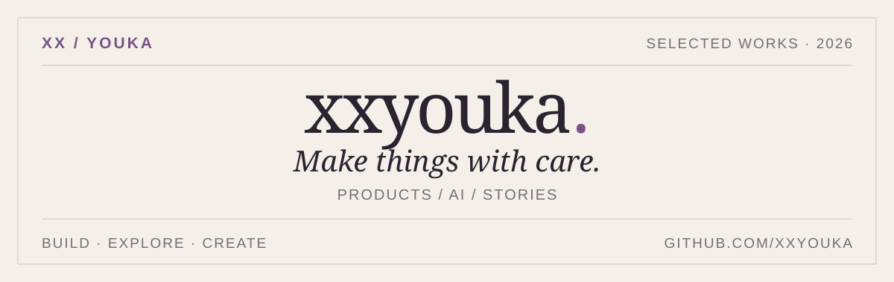

# GitHub主页

> GitHub 个人主页 README（`xxyouka/xxyouka`）：用一篇 Markdown 把作品、工具和经历排成一份可滚动的自我介绍。

**目录**：仓库根目录　·　**形态**：GitHub Profile README（纯 Markdown + SVG）　·　**最近提交**：2026-11-11

## 里面有什么

- **关于**：把想法做成作品；一句话中英自我介绍
- **01 / 精选作品**：校园猫猫、pet-id、一只猫的第九条命、双人食刻
- **02 / 更多公开项目**：弹幕音乐播放器、BitClock、Reticence、天机阁
- **03 / 经历与工具**：工作台抽屉
- 页脚：作品集、GitHub、邮箱入口

## 怎么改

没有构建步骤，直接编辑 `README.md` 即可；封面图用 `<picture>` 按亮 / 暗色切换：

```html
<picture>
  <source media="(prefers-color-scheme: dark)" srcset="assets/folio-20261102-dark.svg">
  
</picture>
```

## 目录

| 路径 | 内容 |
| --- | --- |
| `README.md` | 主页正文 |
| `assets/folio-20261102-*.svg` | 当前封面（亮 / 暗） |
| `assets/cover-*.svg`、`studio-*.svg`、`type-*.svg` | 历史备选封面，未在 README 引用 |

## 注意

- 这是 GitHub 个人主页展示仓库，不是网站源码；完整作品集在 <https://xxyouka.github.io/>。
- 图片走相对路径，改文件名要同步改 README 里的 `srcset`。
- README 的锚点由 GitHub 生成；中文标题链接使用 `#user-content-...`，改标题后要同步导航。

## 延伸阅读

[README.md](README.md) · <https://github.com/xxyouka>

---

<sub>2026-11-11 据仓库 README 与目录内容整理；有变化请直接改本文件。</sub>
