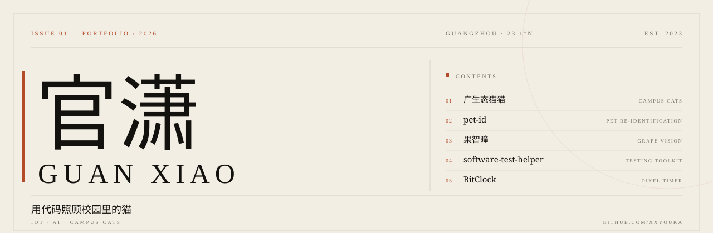

<picture>
  <source media="(prefers-color-scheme: dark)" srcset="assets/cover-dark.svg">
  
</picture>

<a href="https://xxyouka.github.io/portfolio/">作品集 PORTFOLIO ↗</a>

 

<b>ABOUT</b>　·　关于

## 用代码照顾校园里的猫。

在广州读书。做小程序、做视觉模型、做测试工具，也做一点猫的事。

*Based in Guangzhou. I build mini programs, vision models and testing tools — mostly around campus cats.*

> **NOW**　广生态猫猫 3.11.x　·　pet-id Top-1 84.4%　·　2026 全国大学生软件测试大赛 · 开发者测试

 

<b>01 / SELECTED WORKS</b>　·　精选作品

## 六件认真做过的东西。

| № | 项目 PROJECT | 年份 |
| ---: | :--- | ---: |
| 01 | **广生态猫猫** CAMPUS CATS 校园流浪猫的档案、偶遇打卡与救助进展平台。微信小程序原生 + CloudBase，75 个云函数、4,145 条自动化用例。 | 2025– |
| 02 | **pet-id** PET RE-ID 通用宠物个体识别：检测 + 特征 + 底库检索。112 只、1,236 张底库，留出集 Top-1 84.4%，单张 1–2 秒。 | 2026 |
| 03 | **果智瞳** GRAPE VISION 用视觉模型看葡萄的病虫害和成熟度，把经验判断变成可复用的图像证据。挑战杯省铜。 | 2026 |
| 04 | **software-test-helper** TESTING TOOLKIT 软件测试竞赛辅助工具：用例模板、Bug 清单、JUnit 片段与报告导出。 | 2025– |
| 05 | **BitClock** PIXEL TIMER 像素风电脑使用时长追踪器，把时间变成一块会生长的像素屏。Svelte 构建。 | 2026 |
| 06 | **danmu-player** DANMAKU PLAYER 一款集成 B 站弹幕的音乐播放器。TypeScript 构建。 | 2026 |

还有一些没开源的实验：天机阁 · Reticence · 双人食刻 · 《一只猫的第九条命》。

 

<b>02 / HONORS</b>　·　荣誉

## 比赛留下的记录。

| 年份 | 比赛 | 成绩 |
| ---: | :--- | :--- |
| 2025 | 全国大学生软件测试大赛 | 国家级二等奖 |
| 2026 | 广东省职业院校学生专业技能大赛 · 软件测试 | 省级二等奖 |
| 2026 | “挑战杯”广东大学生创业计划竞赛 · 果智瞳 | 省级铜奖 |

 

<b>03 / TOOLBOX</b>　·　工具

## 顺手会用的东西。

**客户端 Client**　微信小程序 · CloudBase · Vue · Svelte · TypeScript
**视觉 Vision**　Python · OpenCV · 目标检测 · 数据标注与评估
**测试 Testing**　Java · JUnit 5 · JaCoCo · PIT · Selenium
**设备 Device**　ESP32 · C · 串口与蓝牙联调

 

---

ISSUE 01 · 2026 · GUANGZHOU　—　[作品集](https://xxyouka.github.io/portfolio/)　·　[GitHub](https://github.com/xxyouka)　·　封面为两版自绘 SVG，排版用 Georgia 与宋体。