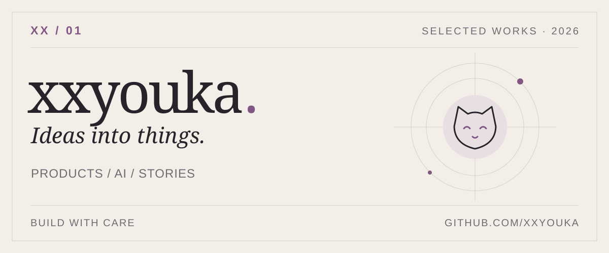

<picture>
  <source media="(prefers-color-scheme: dark)" srcset="assets/cover-20261102-dark.svg">
  
</picture>

<a href="https://xxyouka.github.io/">作品集 PORTFOLIO ↗</a>　·　<a href="mailto:1420272691@qq.com">联系 CONTACT ↗</a>

---

<b>ABOUT</b>　·　关于

## 把想法，做成作品。

你好，我是 **xx / xxyouka**。我做微信小程序、AI 应用和互动作品，喜欢从具体场景出发，把想法做成可以使用、体验和持续改进的东西。

*I build mini programs, AI applications and interactive experiences, turning ideas into things people can use.*

---

<b>01 / SELECTED WORKS</b>　·　精选作品

## 从真实场景出发。

### [校园猫猫 ↗](https://xxyouka.github.io/#project/cat)

微信小程序 · CLOUDBASE

让校园里的猫咪信息可以被记录、查找和持续维护。围绕个体档案连接相册、相遇记录与救助进展。  
[公开代码：核心档案版](https://github.com/xxyouka/campus-cat-platform)

### [pet-id ↗](https://xxyouka.github.io/#project/pet)

图像识别 · 个体检索

从检测、特征提取到检索，探索如何区分外观相似的宠物个体。2026 年 11 月测试台记录的 199 张留出图 Top-1 为 84.4%（测试口径，非线上准确率）。

### [一只猫的第九条命 ↗](https://jiutiaoming.pages.dev/)

互动叙事 · H5 · 生成式 AI

以流浪猫的生命旅程为线索，通过四次选择走向不同结局，把分支叙事、插画和声音组合成可体验的作品。  
[查看创作详情](https://xxyouka.github.io/#project/ninth)

### [双人食刻 ↗](https://xxyouka.github.io/#project/meal)

微信小程序 · CLOUDBASE

围绕两个人的日常餐桌，把共享菜谱、点菜、库存和做饭轮值放进同一个空间。

---

<b>02 / MORE ON GITHUB</b>　·　更多公开项目

## 一些顺手做出来的工具。

- **[弹幕音乐播放器](https://github.com/xxyouka/danmu-player)** — 把音乐、同步歌词与 B 站弹幕放在一起的桌面播放器。Electron · React · TypeScript
- **[BitClock](https://github.com/xxyouka/BitClock)** — 用像素风界面记录和回顾电脑使用时间。Tauri · Svelte · Rust
- **[Reticence](https://github.com/xxyouka/Reticence)**　·　**[天机阁](https://github.com/xxyouka/tianjige)** — 更多实验和作品。

---

<b>03 / EXPERIENCE</b>　·　经历与工具

## 做过的事，用过的工具。

- **产品与开发**：微信小程序 · CloudBase · JavaScript / TypeScript · Python
- **视觉与 AI**：OpenCV · 目标检测 · 特征检索 · 数据评估
- **测试与设备**：Java · JUnit 5 · JaCoCo · PIT · ESP32

曾参与软件测试与创新创业竞赛：全国大学生软件测试大赛国家级二等奖、广东省职业院校学生专业技能大赛软件测试省级二等奖，以及“挑战杯”广东大学生创业计划竞赛省级铜奖（果智瞳）。

 

---

ISSUE 01 · 2026　—　[作品集](https://xxyouka.github.io/)　·　[GitHub](https://github.com/xxyouka)　·　[邮箱](mailto:1420272691@qq.com)
